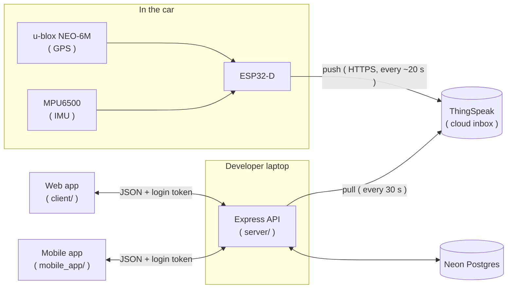

# Car Tracker and Driver Rater

An **ESP32** with a **GPS** and an **IMU** sits in the car and records the speed, acceleration, braking and cornering once every second. A back-end turns that data into **trips**, finds the harsh driving events and gives every trip a **score from 0 to 10**. A **website** shows each trip on a map with charts, and a **mobile app** shows a short summary.

The idea is simple: the driver uses it to **check and correct their own driving**. Comparing with your own past trips is possible, comparing between people is _not_ the goal.

> [!NOTE]
> This is **not** a standalone project, it is the assignment of the **Robotics and IoT** module ( first semester ) at the University of Mauritius. The scope was defined by the team.

---

## How It Works



1. The **ESP32** never receives anything. It only pushes one row per second ( in batches ) to **ThingSpeak** through the phone's hotspot
2. **ThingSpeak** is the always-on inbox, so the data is kept even when the car and the laptop are off
3. The **API** copies the new rows into our own **Postgres** database, splits them into trips, detects the harsh events and scores every trip
4. The **web** and **mobile** apps only ever talk to the API, never to ThingSpeak or to the database directly

> [!TIP]
> Every part has its own `README.md` with the details ( wiring, setup, API reference ... ). They are listed in [Repository Structure](#repository-structure).

---

# Features

- **Trips** that are split automatically, with distance, top speed and the strongest G in every direction
- A **score from 0 to 10** and a rating ( **Bad** / **Normal** / **Good** ) for every trip
- A **route map** coloured by how hard the car was pushed, with pins on the harsh events
- **Speed and G-force charts**, and a **direction-meter** ( radar ) that shows how you accelerate, brake and corner
- **Hardware status**: is the ESP32 online and are its GPS and IMU working
- **Personal places** ( _"Home"_, _"University"_ ... ) so that trips are named "Home to University" and not by coordinates
- **Accounts**: every user adds their own ThingSpeak channel and only ever sees their own data
- Works at **phone width** on the web and has a separate **Flutter** mobile app

---

# Repository Structure

| Directory                     | What it is                                                          | Details                                                                                            |
| ----------------------------- | ------------------------------------------------------------------- | -------------------------------------------------------------------------------------------------- |
| [`firmware/`](./firmware)     | Arduino C++ sketch for the ESP32-D, plus the wiring diagram         | [`firmware/README.md`](./firmware/README.md)                                                       |
| [`server/`](./server)         | Node.js / Express API, the sync from ThingSpeak, trips and scoring  | [`server/README.md`](./server/README.md)                                                           |
| [`client/`](./client)         | The web app ( React, Vite, Tailwind, shadcn/ui, Leaflet, Recharts ) | [`client/README.md`](./client/README.md)                                                           |
| [`mobile_app/`](./mobile_app) | The Flutter mobile app ( a read-only companion )                    | [`mobile_app/README.md`](./mobile_app/README.md) and [`START_HERE.md`](./mobile_app/START_HERE.md) |

```
car-tracker-rater/
├── README.md
├── firmware/       # ESP32-D sketch + wiring diagram
├── server/         # Express API + Postgres ( Knex migrations )
├── client/         # web app
└── mobile_app/     # Flutter app
```

The folders are separate on purpose, each one has its own tools and dependencies, and keeping them in **one** repository keeps the API contract next to both apps that use it.

---

# Usage

## Requirements

| For           | You need                                                                                                               |
| ------------- | ---------------------------------------------------------------------------------------------------------------------- |
| Everything    | A free [ThingSpeak](https://thingspeak.com/) account and a **private** channel                                         |
| `firmware/`   | The hardware ( see below ), the [Arduino IDE](https://www.arduino.cc/en/software) and a phone hotspot                  |
| `server/`     | [Node.js](https://nodejs.org/) 18 or newer and a Postgres database ( we use a free [Neon](https://neon.com/) project ) |
| `client/`     | Node.js 20.19 or newer ( or 22.12 or newer )                                                                           |
| `mobile_app/` | [Flutter](https://flutter.dev/) ( optional )                                                                           |

### Hardware

- ESP32-D ( ESP-32D )
- u-blox NEO-6M GPS module
- MPU6500 IMU ( accelerometer + gyroscope )
- 1 red and 1 green LED

<p align="center">
  
</p>

## Setting Up Everything

1. Clone the repository:

   ```bash
   git clone https://github.com/Sunhaloo/car-tracker-rater.git
   cd car-tracker-rater
   ```

2. **ThingSpeak**: create a private channel with the six fields listed in [`firmware/README.md`](./firmware/README.md#setup), and note down the **channel ID**, the **write key** and the **read key**

3. **Firmware**: wire the board, put your WiFi and the ThingSpeak **write** key inside `firmware/car_tracker/secrets.h` and flash the sketch. Follow [`firmware/README.md`](./firmware/README.md)

4. **Server**: create the database tables and start the API:

   ```bash
   cd server
   npm install
   cp .env.example .env
   # fill in the `.env` file first ( see `server/README.md` )
   npx knex migrate:latest
   npm run dev
   ```

5. **Web app**, in a second terminal:

   ```bash
   cd client
   npm install
   cp .env.example .env
   npm run dev
   ```

6. Open `http://localhost:5173/`, **register**, then add your ThingSpeak channel ( channel ID + **read** key ) inside `Settings` > `Devices`

> [!IMPORTANT]
> The web app **must** run on port `5173`. The API's CORS rule only allows that origin, so another port is blocked by the browser.

> [!NOTE]
> The **mobile app** has its own setup, see [`mobile_app/START_HERE.md`](./mobile_app/START_HERE.md). It talks to the same API ( on an Android emulator use `10.0.2.2` instead of `localhost` ).

---

# Good to Know

## Scoring

> [!IMPORTANT]
> **Speed is never scored**, it is only displayed. Only three things count, with equal weight: **hard acceleration**, **hard braking** and **hard cornering** ( G above `0.30 g` ).

$$E_{10} = \frac{N}{d / 10}$$

$$\text{score} = \operatorname{clamp}\left(10 - \frac{10 \cdot E_{10}}{r_{\text{bad}}},\ 0,\ 10\right)$$

where $N$ is the number of harsh events, $d$ is the distance in km, $E_{10}$ is the number of events per 10 km and $r_{\text{bad}}$ ( `rBad` in the config ) is the event rate that gives a score of 0.

A **higher** score is a better driver: below 4 is **Bad**, 4 to below 8 is **Normal** and 8 or more is **Good**. Trips shorter than 1 km get no score. The threshold and `rBad` live in **one** file ( `server/config/index.js` ) and the trips can be rebuilt from the raw data whenever they change, see [`server/README.md`](./server/README.md).

## Conventions Used Everywhere

- All times are stored and sent in **UTC**, and converted to **Mauritius time** ( UTC+4 ) only for display
- **Lateral G is positive when turning right** ( the car's direction ), the same rule in the firmware, the database and every chart
- A missing GPS fix is **never** stored as `0,0`, the position is simply left out
- Place names come from **your own places** and a built-in list of towns, no online geocoding service is ever used

## Privacy and Security

- Each user only ever sees their own devices, trips and places ( someone else's data answers `404` )
- Passwords are hashed with **bcrypt**, logins use a signed **JWT**
- The ThingSpeak **read** key is stored **encrypted** ( AES-256-GCM ) and is never sent back to any app; the **write** key is never stored, only the ESP32 has it
- No secret is ever committed: `.env` files and `firmware/car_tracker/secrets.h` are git-ignored, only the `.example` files are committed

> [!WARNING]
> Trips and places reveal **where you live and drive**. Keep real coordinates out of the repository and empty the database tables before making it public.

## Limitations

- Data is about **a minute** behind the car ( ESP32 upload ~20 s + the API's sync every 30 s )
- The API runs on a **developer laptop** ( `localhost` ), the sync is a long-running process with a timer
- The accelerometer measures gravity too, so the board **must** be rigidly mounted, level and calibrated while parked on level ground
- ThingSpeak's free tier allows 8 fields and one upload every 15 seconds
- Up to ~20 seconds of data are lost if the ESP32 loses power

---

# Technologies Used

| Part        | Technologies                                                                               |
| ----------- | ------------------------------------------------------------------------------------------ |
| Firmware    | Arduino C++ on an ESP32-D, `MPU9250_WE` ( IMU ) and `TinyGPSPlus` ( GPS ) libraries        |
| Cloud inbox | ThingSpeak ( free tier )                                                                   |
| Server      | Node.js, Express 5, Knex.js, PostgreSQL ( Neon ), bcryptjs, jsonwebtoken, Node's `crypto`  |
| Web         | React 19, Vite, Tailwind CSS 4, shadcn/ui, Recharts, Leaflet + OpenStreetMap, React Router |
| Mobile      | Flutter ( Dart )                                                                           |
