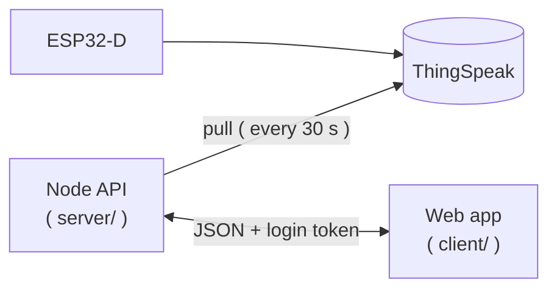

# Car Tracker Web App

The web dashboard of the **Car Tracker and Driver Rater**. It shows your past trips, the score of each trip, the route on a map coloured by how hard the car was pushed, speed and G-force charts and whether the ESP32 and its sensors are alive.

It is a plain **React** single-page application ( JavaScript / JSX, **no** TypeScript ) that only ever talks to our own Express API ( `server/` ). It never talks to ThingSpeak or to the database directly.



> [!NOTE]
> Resources used while building and learning:
>
> - [React](https://react.dev/) and [Vite](https://vite.dev/) documentation
> - [shadcn/ui](https://ui.shadcn.com/) ( components and charts ) and [Tailwind CSS](https://tailwindcss.com/docs)
> - [React Leaflet](https://react-leaflet.js.org/) documentation and [Leaflet](https://leafletjs.com/reference.html)'s reference
> - [Recharts](https://recharts.org/) documentation
> - [React Router](https://reactrouter.com/) documentation

---

# Features

- Register / login with a username ( the login token is kept in `localStorage`, with a fallback to memory if the browser blocks it )
- **Past trips** table with the score, a colour **and** text rating, and a "last 5 trips" comparison
- **Trip view** with the event counts, a **direction-meter** ( radar ), the route map and the speed / G charts
- **Hardware status** page for the ESP32, GPS and IMU, refreshed every 10 seconds
- **Settings** to manage your ThingSpeak devices and your own named places ( _"Home"_, _"University"_ ... )
- Works at phone width ( no sideways page scroll ) and follows your system's light / dark mode

## Pages

| Route        | Page       | What it shows                                                  |
| ------------ | ---------- | -------------------------------------------------------------- |
| `/login`     | Log in     | Username and password                                          |
| `/register`  | Register   | Username, email and password ( at least 8 characters )         |
| `/`          | Past trips | Finished trips, newest first                                   |
| `/trips/:id` | Trip view  | Everything about **one** trip ( the main page )                |
| `/status`    | Status     | ESP32 online / offline, GPS and IMU state, last known position |
| `/settings`  | Settings   | **Devices** and **Places** tabs                                |

### Past trips

- Only **rated** trips ( 1 km or more ) are shown, turn on **Show short sessions** to see the rest
- The score and the rating label come **from the API**; the app never works them out itself
- The "last 5 trips" card compares your average score with a baseline

> [!WARNING]
> The baseline ( `BASELINE_SCORE` inside `src/lib/constants.js` ) is a **placeholder**. Replace it once the scoring has been calibrated on clean drives.

### Trip view

- **Header**: the score, the rating, date, duration, distance, max speed and the start / end place. A trip that is still running says "In progress" and has **no** rating; a trip under 1 km explains why it has no score
- **Harsh events**: how many hard accelerations, hard brakings and hard corners ( with the left / right split )
- **Direction-meter**: a radar of the strongest G in each direction on a **fixed** 0 to 0.6 g scale ( so trips can be compared ), a dashed ring at the 0.30 g threshold and an overlay of the average of your last 5 trips
- **Route map**: coloured by the _resultant_ G

  | Colour | Resultant G                         |
  | ------ | ----------------------------------- |
  | Green  | below 0.15 g ( half the threshold ) |
  | Amber  | 0.15 g up to 0.30 g                 |
  | Red    | above 0.30 g                        |
  | Grey   | no G reading                        |

  Pins **A**, **B** and **C** mark the hard accelerations, brakings and corners ( click one for the details ), and `Start` / `End` mark the ends of the route

- **Charts**: speed, and longitudinal + lateral G with dashed lines at +/- 0.30 g. Hovering a chart moves a dot along the route on the map

> [!NOTE]
> The map only draws points that have a GPS position **and** a speed above 3 km/h ( the GPS position jitters while the car is stopped ), and it does **not** join two points that are more than 10 seconds apart ( _a tunnel would otherwise be a straight line through the buildings_ ). The data itself is never changed, this only affects what is drawn.

### Hardware status

One section per device, split into three cards: the **ESP32** ( ONLINE / OFFLINE, the age of its data ), the **GPS** ( with the last known position on a small map ) and the **IMU**.

Grey, orange and green come from the API's `state` ( `unknown`, `warning`, `ok` ) and always come with a word, so the colour is never the only signal. The ESP32 counts as offline once its newest data is **more than 90 seconds** old, which turns both sensors grey ( "unknown" ).

### Settings

- **Devices**: add, edit and delete a ThingSpeak channel. The server checks the channel with ThingSpeak before saving it. The read key is **write-only**: the API never sends it back, so when editing, an empty key field means "keep the current key"
- **Places**: add, edit and delete named places. Click the map to drop the pin or **paste coordinates**, then pick a radius between 20 and 2000 m ( default 150 m ). After **every** change the app asks the API to relabel your old trips so they get the new names

> [!NOTE]
> The coordinate box takes coordinates **only** ( e.g. the ones that Google Maps copies when you right-click a spot ), not place names. Searching for a name would mean sending your home address to a geocoding service, and this project deliberately does not do that.

---

# Usage

## Requirements

- [Node.js](https://nodejs.org/) `20.19` or newer ( or `22.12` or newer )
- The API running on `http://localhost:5000` ( see the `server/` directory )

## Setting Up the Development Environment

1. Install the dependencies:

```bash
cd client
npm install
```

1. Create your `.env` file from the example one:

```bash
cp .env.example .env
```

1. Start the API in **another terminal**:

```bash
cd server
npm run dev
```

1. Start the web app:

```bash
npm run dev
```

The app is now available at `http://localhost:5173/`. Click **Register** to create an account, then add your ThingSpeak channel inside `Settings` > `Devices`.

> [!IMPORTANT]
> You **must** use port `5173`! The API's CORS rule only allows the origin `http://localhost:5173`. If that port is already taken, Vite will quietly pick another one ( `5174` ... ) and every request will be blocked by the browser. If that happens, stop whatever is using `5173`.
>
> You can also make Vite refuse to start in that case:
>
> ```bash
> npm run dev -- --port 5173 --strictPort
> ```

## Scripts

| Command           | What it does                                |
| ----------------- | ------------------------------------------- |
| `npm run dev`     | Development server with hot reload          |
| `npm run build`   | Production build inside `dist/`             |
| `npm run preview` | Serve the production build locally          |
| `npm run lint`    | Lint the code with [Oxlint](https://oxc.rs) |

# Configuration

| Variable       | Default                 | What it is                              |
| -------------- | ----------------------- | --------------------------------------- |
| `VITE_API_URL` | `http://localhost:5000` | Base URL of the API ( no trailing `/` ) |

> [!WARNING]
> Every `VITE_` variable ends up **inside the browser bundle**, so never put a secret in there. The `.env` file is git-ignored; only `.env.example` is committed.

## Constants copied from the server

The API does not send these, so the client keeps its own copy inside `src/lib/constants.js`. If you change one on the server, change it here too!

| Client constant                                                      | Server ( `server/config/index.js` )                         |
| -------------------------------------------------------------------- | ----------------------------------------------------------- |
| `EVENT_THRESHOLD_G` ( 0.30 )                                         | `eventThresholdG`                                           |
| `MIN_TRIP_DISTANCE_KM` ( 1 )                                         | `minTripDistanceKm`                                         |
| `PLACE_RADIUS_MIN_M`, `PLACE_RADIUS_MAX_M`, `PLACE_RADIUS_DEFAULT_M` | `placeRadiusMinM`, `placeRadiusMaxM`, `defaultPlaceRadiusM` |

---

# Rules the App Follows

- The API sends and stores **UTC**; times are converted to **Mauritius time** ( `Indian/Mauritius`, UTC+4 ) only for display
- Lateral G is **positive when turning right** ( the car's direction ), so the labels say "Right turn" / "Left turn" and "Accelerating" / "Braking"
- **Speed is never scored**, it is only displayed
- Scores and ratings come from the API and are **never** recomputed in the browser
- Place names come from the API's labels, no geocoding service is ever called
- The ThingSpeak read key is never shown or logged
- **Every** request goes through **one** helper ( `src/lib/api.js` ) which adds the login token, throws the server's own `{ "error": "..." }` message and, on a `401`, forgets the token and sends you back to the login page

---

# Project Structure

```
client/
├── README.md
├── package.json
├── vite.config.js            # React + Tailwind plugins, the `@/` alias, vendor chunk splitting
├── jsconfig.json             # the `@/` alias for the editor
├── components.json           # shadcn/ui configuration ( generated as `.jsx` )
├── .env.example              # `VITE_API_URL`
├── index.html
└── src/
    ├── main.jsx              # entry point ( sets light / dark, renders `App` )
    ├── App.jsx               # every route ( the big pages load on demand )
    ├── index.css             # Tailwind + shadcn theme colours
    ├── pages/                # one file per route
    ├── components/           # shared pieces at the top: NavBar, Layout, ProtectedRoute, TripsTable, ...
    │   ├── ui/               # shadcn/ui components ( generated --> do not edit by hand )
    │   ├── map/              # EVERYTHING that touches Leaflet ( `TripMap`, `PositionMap`, ... )
    │   ├── trip/             # trip view pieces ( header, charts, direction-meter, ... )
    │   ├── status/           # hardware status cards
    │   └── settings/         # device and place forms, delete confirmation
    ├── context/              # `AuthContext` + `AuthProvider` ( who is logged in )
    ├── hooks/                # `useAuth`
    └── lib/
        ├── api.js            # the ONE API helper
        ├── storage.js        # token in `localStorage` ( try / catch + memory fallback )
        ├── constants.js      # thresholds and settings copied from the server
        ├── format.js         # dates ( Mauritius time ), durations, km, km/h
        ├── track.js          # PURE: which points to draw, G colours, route segments
        ├── downsample.js     # PURE: shrink a long track, keeping the peaks
        ├── coordinates.js    # PURE: parse "latitude, longitude"
        └── theme.js          # follow the system's light / dark mode
```

> [!TIP]
> All the map code lives inside `components/map/` and the rest of the app only ever uses `TripMap`, `PositionMap` and `PlacePickerMap`. If the map library is ever swapped, only that folder changes.

The three files marked **PURE** take plain data and return plain data ( no React, no map library ), so they can be tested with made-up numbers.

## Adding a shadcn/ui Component

```bash
# the components are generated as JavaScript ( `tsx: false` inside `components.json` )
npx shadcn@latest add <component-name>
```

---

# Technologies Used

- React 19 ( JavaScript / JSX ) and Vite
- Tailwind CSS v4
- [shadcn/ui](https://ui.shadcn.com/) ( Radix UI ) and [Lucide](https://lucide.dev/) icons
- Recharts ( through shadcn's chart component )
- Leaflet and React Leaflet, with [OpenStreetMap](https://www.openstreetmap.org/copyright) tiles
- React Router
- Oxlint

# Troubleshooting

| Problem                                           | Likely cause / fix                                                                  |
| ------------------------------------------------- | ----------------------------------------------------------------------------------- |
| "Could not reach the server" everywhere           | The API is not running, or `VITE_API_URL` points to the wrong place                 |
| Requests fail with a CORS error in the browser    | The app is not on port `5173` ( see the **IMPORTANT** box above )                   |
| Sent back to the login page by itself             | The login token expired ( they last 7 days ) ==> simply log in again                |
| Editing a device or place fails with a CORS error | The server's CORS rule needs `PATCH` in `server/app.js` ==> restart the API         |
| Map tiles are grey                                | No internet connection ( the tiles come from OpenStreetMap's tile server )          |
| Trip scores are all `0`                           | The sensor data is noisy ( _board not rigid / not calibrated_ ) ==> see `firmware/` |

# Limitations

- The past trips page shows the **20 newest** trips ( the API's default ), there is no paging yet
- Pages load their data once; a trip that is still in progress does not update by itself ( only the status page refreshes )
- The "last 5 trips" baseline is a placeholder
- A few thresholds are copied from the server by hand ( see the table above )
- No automated tests yet; the pages were checked manually against the running API
- The OpenStreetMap tile server is meant for light use only, which is fine at the scale of this project
