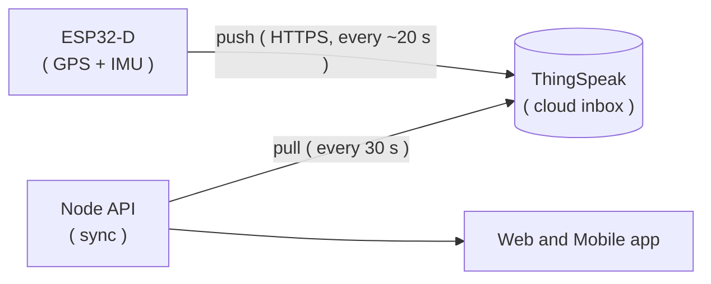
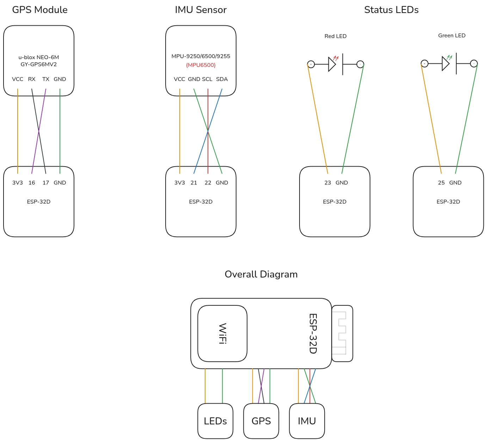

# ESP32-D Firmware

The firmware that runs on the **ESP32-D** inside the car. Once every second it records the car's speed, acceleration, cornering and GPS position, keeps those rows in memory and uploads them in batches to [ThingSpeak](https://thingspeak.com/) through your phone's hotspot.

That is _all_ it does! The ESP32 never receives anything; the backend ( `server/` ) pulls the data out of ThingSpeak and does the trips, scoring and everything else.



> [!NOTE]
> Resources used while building and learning:
>
> - [MPU9250_WE](https://github.com/wollewald/MPU9250_WE) library ( IMU ) by Wolfgang Ewald
> - [TinyGPSPlus](https://github.com/mikalhart/TinyGPSPlus) library ( GPS ) by Mikal Hart
> - ThingSpeak's [BulkWriteJSONData](https://www.mathworks.com/help/thingspeak/bulkwritejsondata.html) documentation
> - The [Arduino IDE](https://www.arduino.cc/en/software) used to write and upload the sketch

---

## Hardware

| Part            | Model                                 | What it gives us                           |
| --------------- | ------------------------------------- | ------------------------------------------ |
| Microcontroller | ESP32-D ( ESP-32D )                   | WiFi, the clock ( via NTP ) and the brain  |
| GPS             | u-blox NEO-6M ( `GY-GPS6MV2` board )  | Position, speed, altitude, satellite count |
| IMU             | MPU6500 ( accelerometer + gyroscope ) | Longitudinal G, lateral G and yaw rate     |
| Status LEDs     | 1 red + 1 green                       | "Is everything working?" at a glance       |

> [!NOTE]
> The IMU is an **MPU6500**. The boards sold as `MPU-9250/6500/9255` look the same but only the MPU6500's chip is on ours ( so there is **no** magnetometer ). We only use the gyroscope's **yaw rate**, roll and pitch are not used.

### Wiring

<p align="center">
  
</p>

| Part      | Part pin         | ESP32 pin | Notes                                      |
| --------- | ---------------- | --------- | ------------------------------------------ |
| GPS       | `VCC`            | `3V3`     |                                            |
| GPS       | `GND`            | `GND`     |                                            |
| GPS       | `TX`             | `GPIO 16` | The ESP32 **receives** on 16 ( `GPS_RX` )  |
| GPS       | `RX`             | `GPIO 17` | The ESP32 **transmits** on 17 ( `GPS_TX` ) |
| IMU       | `VCC`            | `3V3`     |                                            |
| IMU       | `GND`            | `GND`     |                                            |
| IMU       | `SDA`            | `GPIO 21` | Default I2C data pin                       |
| IMU       | `SCL`            | `GPIO 22` | Default I2C clock pin                      |
| Red LED   | `+` ( long leg ) | `GPIO 23` | The other leg goes to `GND`                |
| Green LED | `+` ( long leg ) | `GPIO 25` | The other leg goes to `GND`                |

> [!TIP]
> The GPS's `TX` goes to the ESP32's `RX` pin and the other way around! This is the _one_ wiring mistake that is really easy to make ( _the two wires cross in the diagram_ ).
>
> The IMU talks over I2C at address `0x68`.

> [!WARNING]
> The diagram connects the LEDs **straight** to the pins. That is fine for LED _modules_ that already have a resistor on them, but if you are using bare LEDs, put a resistor ( around 220 ohm ) in series with each one.

---

## Setup

1. Install the [Arduino IDE](https://www.arduino.cc/en/software) ( version 2.x ).

2. Add support for the ESP32 boards:

   - Open `File` > `Preferences` and paste the following inside the "_Additional boards manager URLs_" box:

   ```
   https://espressif.github.io/arduino-esp32/package_esp32_index.json
   ```

   - Open the **Boards Manager** and install `esp32` by **Espressif Systems**.

3. Install the two libraries using the **Library Manager**:

   - `MPU9250_WE` by Wolfgang Ewald
   - `TinyGPSPlus` by Mikal Hart

> [!NOTE]
> There is **no** library called `MPU6500_WE`! Wolfgang Ewald's `MPU9250_WE` library covers the MPU6500 as well, which is why the sketch has `#include <MPU6500_WE.h>`; that header is part of `MPU9250_WE`.

> WiFi, HTTP and I2C libraries ( `WiFi.h`, `HTTPClient.h`, `Wire.h` ... ) come with the ESP32 package, so there is nothing else to install.

1. Clone the repository and open the sketch:

   ```bash
   git clone <repository-url>
   # then open this file with the Arduino IDE
   # INFO: the folder name needs to match the sketch name ==> do not rename `car_tracker`
   firmware/car_tracker/car_tracker.ino
   ```

2. Create your **ThingSpeak** channel ( free account, **private** channel ) with the following fields:

   | Field    | Name           | Meaning                                             |
   | -------- | -------------- | --------------------------------------------------- |
   | `field1` | Speed          | km/h                                                |
   | `field2` | Longitudinal G | positive when accelerating, negative when braking   |
   | `field3` | Lateral G      | positive when turning **right**, negative when left |
   | `field4` | Yaw rate       | deg/s, positive when turning **right**              |
   | `field5` | Uptime         | seconds since the ESP32 booted                      |
   | `field6` | Status bits    | see [Status bits](#status-bits)                     |

   `field7` and `field8` are not used. The **latitude**, **longitude**, **elevation** and **status** text are ThingSpeak's own built-in keys, so nothing to create for those.

3. Create your `secrets.h` file **next to** the `.ino` file by copying the example one:

   ```bash
   cd firmware/car_tracker
   cp secrets.h.example secrets.h
   ```

   Then fill it in:

   ```cpp
   // variables for WiFi credentials ( your phone's hotspot )
   #define WIFI_SSID "<wifi-ssid-here>"
   #define WIFI_PASSWORD "<wifi-password-here>"

   // variables for ThingSpeak credentials
   #define CHANNEL_ID 0000000UL
   #define WRITE_API_KEY "<thingspeak-write-key>"
   ```

> [!WARNING]
> `secrets.h` is listed inside the `.gitignore` file and should **never** be committed!
>
> Only the **write** key goes in here. The **read** key is _not_ used by the ESP32; you enter it ( together with the channel ID ) inside the web app's `Settings` page.

> [!TIP]
> The ESP32 only supports **2.4 GHz** WiFi. If your phone's hotspot is dual-band, make sure it is broadcasting on 2.4 GHz.

1. Plug the ESP32 in with a USB cable ( _a data cable, not a charge-only one_ ), then in the Arduino IDE:

   - `Tools` > `Board` > `esp32` > **ESP32 Dev Module**
   - `Tools` > `Port` > the port of your board
   - Click **Upload**

> [!TIP]
> If the upload gets stuck on `Connecting...`, hold the `BOOT` button on the board until it starts writing.

1. Open the **Serial Monitor** at `115200` baud. You should see the messages from [Serial monitor messages](#serial-monitor-messages).

---

## Mounting and Calibration

> [!IMPORTANT]
> The accelerometer measures **gravity** as well as motion. If the board is tilted, or you hold it in your hand, you get **fake** G values. Data recorded this way is **not usable** for scoring ( _ask me how I know..._ ).

The board must be:

1. **Fixed rigidly** in the car ( no hand, no loose cable pulling on it, no sliding around on the dashboard )
2. **Level**, with the axes lined up with the car:
   - `y` axis pointing **forward** ==> towards the windshield
   - `x` axis pointing to the **right** ==> towards the driver seat
   - `z` axis pointing **up** ==> meaning that you can see the sensor ( component side up )

The sign rules that the whole project uses ( the same for the database and the charts ):

| Value          | Positive ( + )    | Negative ( - )   |
| -------------- | ----------------- | ---------------- |
| Longitudinal G | accelerating      | braking          |
| Lateral G      | turning **right** | turning **left** |
| Yaw rate       | turning **right** | turning **left** |

### Calibration

The IMU is calibrated **once**, inside `setup()`, every time the ESP32 boots ( `autoOffsets()` ). It assumes the board is **flat and still** at that exact moment and shifts all the readings so that it reads "zero G" there.

> [!WARNING]
> The ESP32 reboots whenever the car is started ( _it is powered from the car_ ), so **every drive calibrates itself at engine start**. This means:
>
> - Power it on while the car is parked on **level ground**. If the car is on a slope, that slope gets baked into **every** reading of the trip.
> - Do **not** touch the board or shake the car while you see `Keep the board flat and still - calibrating...` in the serial monitor.
>
> A quick check: with the car parked, the longitudinal and lateral G should be close to `0`. If they are not, the board is tilted or not rigid.

---

## What the LEDs mean

| LED       | Meaning                                                                                                   |
| --------- | --------------------------------------------------------------------------------------------------------- |
| **Red**   | Something is **not** working yet ( the LED is also red during boot )                                      |
| **Green** | **Everything** works: clock synced, WiFi connected, GPS has a fix, IMU answers and the last upload worked |

Only one of the two is on at any time. The LEDs do **not** affect the logging in any way.

> [!NOTE]
> GPS needs a **clear view of the sky** to get a fix. Indoors ( or right after a cold start ) the LED simply stays red for a few minutes. The ESP32 still logs the G values in the meantime, just without a position.

---

## What the Firmware Does

### 1 row per second

The IMU is read **50 times per second** ( every 20 ms ). At the end of every second, all of those readings are squashed into **one row** holding the value with the **largest magnitude** ( _the sign is kept_ ) for speed, longitudinal G, lateral G and yaw rate.

> This is so that a hard braking that only lasts 200 ms is **not** averaged away.

- Rows are **not logged** until the clock has been synced over NTP ( `pool.ntp.org`, `time.google.com` ). This is the _only_ thing that stops the logging, no WiFi or no GPS does **not**.
- Timestamps are always in **UTC**.
- With no GPS fix, `latitude` and `longitude` are left **out** of the row ( never `0,0` ).
- A value from a sensor that did not answer is left out as well ( it shows up as `null` in the database ).

### Fields sent to ThingSpeak

| Key                     | Content                                                        |
| ----------------------- | -------------------------------------------------------------- |
| `created_at`            | Timestamp in ISO 8601 UTC, distinct for every row              |
| `field1` to `field4`    | Speed, longitudinal G, lateral G, yaw rate                     |
| `field5`                | Uptime in seconds ( a **drop** means a reboot ==> a new trip ) |
| `field6`                | [Status bits](#status-bits)                                    |
| `latitude`, `longitude` | Only when the GPS has a fix                                    |
| `elevation`             | Only when the GPS has a fix and an altitude                    |
| `status`                | Satellite count as text, e.g. `sats:7`                         |

### Status bits

`field6` tells the backend ( and the web app's _Hardware Status_ page ) how the sensors are doing:

| Bit | Value | Meaning                                             |
| --- | ----- | --------------------------------------------------- |
| 0   | 1     | GPS is **talking** ( data arrives from the module ) |
| 1   | 2     | GPS has a **fix**                                   |
| 2   | 4     | IMU is **responding**                               |

| `field6` | GPS indicator | IMU indicator |
| -------- | ------------- | ------------- |
| 0        | grey          | grey          |
| 1        | orange        | grey          |
| 3        | green         | grey          |
| 4        | grey          | green         |
| 5        | orange        | green         |
| 7        | green         | green         |

> [!NOTE]
> `2` and `6` should never happen ( _a fix without the module talking_ ).

### Uploading to ThingSpeak

- Every **20 seconds** the buffered rows ( up to **150** at a time ) are sent with **one** `bulk_update` request over HTTPS.
- ThingSpeak's free tier needs **at least 15 seconds** between two bulk requests. The sketch has a `static_assert` that refuses to compile if you set the interval below that.
- The HTTP response decides what happens to the rows:

  | Response      | What it means                                       | What the ESP32 does                       |
  | ------------- | --------------------------------------------------- | ----------------------------------------- |
  | `202`         | Accepted                                            | Removes the uploaded rows from the buffer |
  | `429`         | Too soon ( "Retry later" )                          | Keeps the rows and tries again later      |
  | Anything else | Failed ( e.g. a negative code = could not connect ) | Keeps the rows and tries again later      |

- The buffer holds **600 rows** ( 10 minutes ). If it ever fills up ( _a long WiFi outage_ ), the **oldest** row is dropped to make room for the new one.
- WiFi is kept alive without blocking. If the connection drops, the ESP32 **keeps logging** and uploads everything once it is back; the timestamps stay correct.

> [!WARNING]
> If the power is cut, the rows still waiting in the buffer ( **up to ~20 seconds** ) are lost. This is a known limitation.

### Timing summary

| What                      | Value       | Constant in the sketch |
| ------------------------- | ----------- | ---------------------- |
| IMU reading               | every 20 ms | `IMU_INTERVAL_MS`      |
| Upload to ThingSpeak      | every 20 s  | `UPLOAD_INTERVAL_MS`   |
| GPS data considered stale | after 2 s   | `GPS_FRESH_MS`         |
| WiFi reconnection attempt | every 10 s  | `WIFI_RETRY_MS`        |
| Buffer size               | 600 rows    | `BUF_CAP`              |
| Rows per upload           | 150 rows    | `MAX_BATCH_ROWS`       |

---

## Serial monitor messages

Open the monitor at `115200` baud. A healthy start looks like this:

```
MPU6500 is connected
Keep the board flat and still - calibrating...
Calibration done!
WiFi connected, NTP started
Clock synced, logging starts
row 1792900000 | spd 0.0 long 0.01 lat -0.01 yaw 0.1 | st 7 sats 8 | buf 1
...
Upload OK: 20 rows in 850 ms, 0 left in buffer
```

| Message                                                 | What it means / what to do                                                                 |
| ------------------------------------------------------- | ------------------------------------------------------------------------------------------ |
| `MPU6500 does not respond - check wiring/address`       | IMU not found. Check `SDA` / `SCL` / power. It stays "not responding" until you **reboot** |
| `WiFi not connected, retrying...`                       | Wrong credentials in `secrets.h`, hotspot is off or it is not on 2.4 GHz                   |
| _( no `Clock synced` message )_                         | No internet on the hotspot ==> NTP cannot sync, so **nothing is logged**                   |
| `st 1` / `st 5`                                         | GPS is talking but has no fix yet ==> go outside, wait a few minutes                       |
| `st 0` / `st 4`                                         | GPS module is silent ==> check the `TX` / `RX` wires ( crossed? )                          |
| `Upload skipped: no WiFi (rows stay in the buffer)`     | No WiFi right now, the rows are safe in the buffer                                         |
| `Upload refused (429, too soon), keeping N rows`        | ThingSpeak's 15 s limit was hit ( _two ESP32s on one channel?_ )                           |
| `Upload failed, HTTP code X after Y ms, keeping N rows` | Network problem or wrong channel ID / write key                                            |
| `Buffer full: dropped oldest row`                       | The outage lasted over 10 minutes, the oldest data is being lost                           |

> [!NOTE]
> Duplicate timestamps are **silently** dropped by ThingSpeak even when it answers `202`. If data seems to be missing, check the timestamps first.

---

## Project Structure

```
firmware/
├── README.md
├── .gitignore
├── assets/
│   └── wiring-diagram.png
└── car_tracker/
    ├── car_tracker.ino       # the sketch ( `setup()` and `loop()` ) --> sensors, buffer, upload
    ├── types.h               # `Row`, `Peak` and `RowFlags` ( shared types )
    ├── secrets.h.example     # template for the credentials
    └── secrets.h             # YOUR credentials ( user-created --> git-ignored )
```

---

## Limitations

- The board **must** be rigidly mounted and calibrated while parked on level ground; otherwise the G values are not usable
- No live tracking ==> data arrives about **a minute** after it was recorded ( upload every ~20 s + the backend's sync every 30 s )
- Up to ~20 seconds of rows are lost when the power is cut
- Uses ThingSpeak's free tier: 8 fields, 15 seconds between uploads
- The upload uses `setInsecure()`, meaning the HTTPS **certificate is not checked**. The write key travels encrypted, but the ESP32 does not verify that it is really talking to ThingSpeak
- If the IMU fails during boot, it is reported as "not responding" until the next reboot
- Needs a phone hotspot ( or any 2.4 GHz WiFi ) in the car
