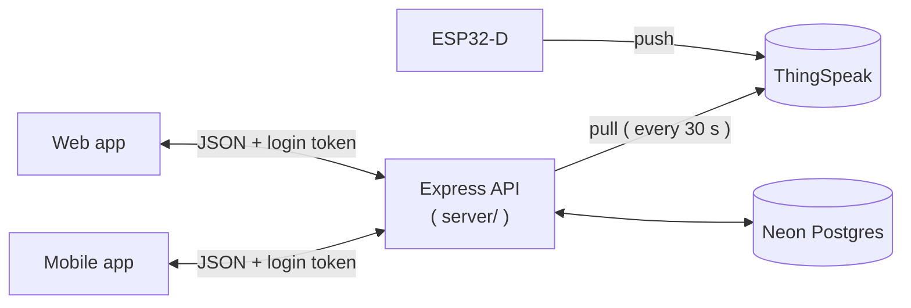
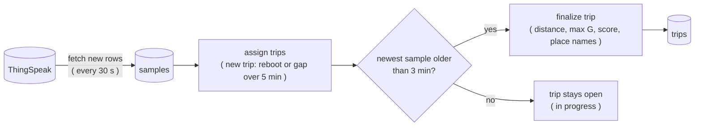

# Car Tracker API

The back-end of the **Car Tracker and Driver Rater**. It is a plain **Node.js / Express** API ( JavaScript, **no** TypeScript ) that does _everything_ between the ESP32 and the two apps:

1. **Copies** the rows that the ESP32 uploaded to [ThingSpeak](https://thingspeak.com/) into our own Postgres database ( [Neon](https://neon.com/) )
2. **Splits** them into trips, works out the distance and detects the harsh driving events
3. **Scores** every trip from 0 to 10 and gives it a rating ( Bad / Normal / Good )
4. **Names** the start and the end of every trip ( "Home", "Port Louis" ... ) without any online geocoding service
5. **Serves** all of this as JSON to the web app ( `client/` ) and the Flutter app ( `mobile_app/` )



> [!NOTE]
> Resources used while building and learning:
>
> - [Express](https://expressjs.com/) and [Knex.js](https://knexjs.org/) documentation
> - [Neon](https://neon.com/docs) documentation
> - [ThingSpeak's REST API](https://www.mathworks.com/help/thingspeak/rest-api.html) documentation
> - [Node.js `crypto`](https://nodejs.org/api/crypto.html) documentation ( AES-256-GCM )
> - [jsonwebtoken](https://github.com/auth0/node-jsonwebtoken) and [bcryptjs](https://github.com/dcodeIO/bcrypt.js)

---

# Features

- **Accounts**: register and log in with a username ( passwords hashed with bcrypt, login token valid for 7 days )
- **Per-user data**: every user has their own devices, trips and places, and **cannot** see anybody else's
- **Devices**: each user adds their own ThingSpeak channel, the _read key_ is stored **encrypted** and is never sent back
- **Sync**: new rows are copied from ThingSpeak when the API starts and then every 30 seconds ( safe to run any number of times )
- **Trips**: split automatically, with distance, strongest G in every direction, a score and a rating
- **Places**: personal named places with a radius, and a built-in list of Mauritian towns as a fallback
- **Hardware status**: is the ESP32 online and are its GPS and IMU working
- **Mobile payload**: a tiny text-only summary of the latest trip

---

# How It Works

## The sync pipeline

Nobody runs the sync by hand. It starts together with the API ( to catch up on everything that was uploaded while the laptop was off ) and then repeats every **30 seconds**.



> [!NOTE]
> `samples` is a **raw copy** of ThingSpeak and its values are never edited. `trips` is only a **cache** that can be rebuilt from `samples` at any time ( see [Rebuilding the trips](#rebuilding-the-trips) ).

- **Idempotent**: a unique key on `( device_id, created_at )` skips rows that we already have, so running the sync twice ( or two APIs at once ) does no harm
- A device that fails ( wrong key, ThingSpeak is down ) is logged and **does not** stop the other devices; it is simply retried on the next tick
- ThingSpeak returns at most **8000 rows** per read ( about 2 h 13 min of data ). If that limit is hit a warning is logged and the next tick continues from where this one stopped

## Trips

| Rule                          | Value                                                                                                                              |
| ----------------------------- | ---------------------------------------------------------------------------------------------------------------------------------- |
| A **new trip** starts when    | it is the first sample, the ESP32 **rebooted** ( `uptime` went down ) or there is a **gap of more than 5 minutes**                 |
| A trip is **closed** when     | its newest sample is **older than 3 minutes**                                                                                      |
| Late rows ( hotspot dropout ) | land in the right trip, even a closed one, and its summary is recomputed                                                           |
| **Distance**                  | each row adds $\frac{v}{3.6} \cdot \min(\Delta t,\ 5)$ metres ( $v$ is the speed in km/h and $\Delta t$ the seconds since the previous row, capped at 5 s ), **not** GPS positions, because GPS jitters when stopped |
| Trips under **1 km**          | get **no score** ( the API rates them "Not enough data" ) and are hidden from the list unless `all=true`                           |

## Scoring

> [!IMPORTANT]
> **Speed is never scored.** Only three kinds of events count, with equal weight:
>
> - **Hard acceleration**: longitudinal G above `+0.30 g`
> - **Hard braking**: longitudinal G below `-0.30 g`
> - **Hard cornering**: lateral G beyond `+/-0.30 g` ( left or right )

An **event** is a run of consecutive over-threshold rows of one type, counted **once**.

$$E_{10} = \frac{N}{d / 10}$$

$$\text{score} = \min\left(10,\ \max\left(0,\ 10 - \frac{10 \cdot E_{10}}{r_{\text{bad}}}\right)\right)$$

where $N$ is the number of harsh events, $d$ is the distance in km, $E_{10}$ is the number of events per 10 km and $r_{\text{bad}}$ ( `rBad` in `config/index.js` ) is the event rate that gives a score of 0.

| Score        | Rating     |
| ------------ | ---------- |
| below 4      | **Bad**    |
| 4 to below 8 | **Normal** |
| 8 or more    | **Good**   |

A **higher** score is a better driver.

## Place names

Labels are written **once**, when a trip is finalised ( never on page view ), by looking at the start and end point:

1. A **place of the same user** whose radius contains the point ==> its name ( the closest centre wins if several match )
2. Otherwise the **nearest built-in town** ( `config/towns.js`, about 26 towns ) within 6 km
3. Otherwise the **raw coordinates**, with 4 decimals

Adding or changing a place does **not** touch old trips by itself; `POST /api/places/relabel` rewrites the labels of all of the user's finished trips ( the web app calls it after every change ).

> [!WARNING]
> `config/towns.js` is committed to a **public** repository. Never add your home coordinates to it; use a personal place ( stored in the database only ) instead.

## Hardware status

The ESP32 counts as **offline** when its newest row in the database is **more than 90 seconds** old. That age includes the firmware's upload delay ( ~20 s ) and the sync interval ( 30 s ), so a healthy device is at most ~51 s old.

When it is offline, the API reports GPS and IMU as `unknown`. When it is online, the sensor states come from the status bits in `field6`:

| Bit | Value | Meaning               |
| --- | ----- | --------------------- |
| 0   | 1     | GPS is **talking**    |
| 1   | 2     | GPS has a **fix**     |
| 2   | 4     | IMU is **responding** |

---

# Usage

## Requirements

- [Node.js](https://nodejs.org/) **18** or newer ( Express 5 and the built-in `fetch` )
- A **Postgres** database with SSL ( we use a free [Neon](https://neon.com/) project )
- At least one **ThingSpeak** channel that your ESP32 uploads to ( see `firmware/` )

## Setting Up the Development Environment

1. Install the dependencies:

```bash
cd server
npm install
```

1. Create your `.env` file from the example one:

```bash
cp .env.example .env
```

1. Fill in the `.env` file ( see the table below ). Generate the two secrets with:

```bash
# ENCRYPTION_KEY ==> exactly 64 hex characters ( 32 bytes )
node -e "console.log(require('crypto').randomBytes(32).toString('hex'))"

# JWT_SECRET ==> run the same command again --> use a DIFFERENT value
node -e "console.log(require('crypto').randomBytes(32).toString('hex'))"
```

1. Create the database tables:

```bash
npx knex migrate:latest
```

1. Start the API ( restarts by itself when you save a file ):

```bash
npm run dev
```

1. Check that it is alive:

```bash
curl http://localhost:5000/health
# {"ok":true}
```

The API listens on **all network interfaces** ( `0.0.0.0` ) and starts the sync straight away.

## Environment Variables

| Variable                | Needed by            | What it is                                                                         |
| ----------------------- | -------------------- | ---------------------------------------------------------------------------------- |
| `PORT`                  | the API ( optional ) | Port to listen on ( default `5000` )                                               |
| `DATABASE_URL`          | the API              | Neon connection string, keep `?sslmode=require&channel_binding=require` at the end |
| `JWT_SECRET`            | the API              | Signs the login tokens                                                             |
| `ENCRYPTION_KEY`        | the API              | 64 hex characters, encrypts the users' ThingSpeak read keys                        |
| `THINGSPEAK_CHANNEL_ID` | **dev scripts only** | Used by `scripts/seed-dev.js` and `test-js-files/test-thingspeak.js`               |
| `THINGSPEAK_READ_KEY`   | **dev scripts only** | Same as above                                                                      |

The API refuses to start if `DATABASE_URL`, `JWT_SECRET` or `ENCRYPTION_KEY` is missing.

> [!WARNING]
> Never commit your `.env` file ( it is git-ignored ).
>
> - Changing `ENCRYPTION_KEY` makes **every** stored read key unreadable; every user would have to enter their key again
> - Changing `JWT_SECRET` logs **everybody** out

## Creating Your First Account

The easiest way is the web app's **Register** page. You can also use `curl`:

```bash
# WARNING: use a throwaway password ==> it ends up in your shell history
curl -X POST http://localhost:5000/api/auth/register \
  -H "Content-Type: application/json" \
  -d '{"username":"demo","email":"demo@example.com","password":"change-me-1234"}'
```

Or create a user **and** a device from the values inside your `.env` file in one go:

```bash
node scripts/seed-dev.js <username> <email> <password>
```

> [!NOTE]
> `seed-dev.js` names the device "Mazda 3" and, if the username or channel already exists, it **overwrites** the email, the password and the key. It is only meant for development.

## Scripts

| Command                                              | What it does                                                  |
| ---------------------------------------------------- | ------------------------------------------------------------- |
| `npm run dev`                                        | Start the API with `nodemon` ( restarts on every change )     |
| `npm start`                                          | Start the API with `node`                                     |
| `npm run rebuild -- <deviceId \| all>`               | Rebuild the trips ( same as `node scripts/rebuild-trips.js` ) |
| `npx knex migrate:latest`                            | Create / update the database tables                           |
| `node scripts/seed-dev.js <user> <email> <password>` | Create a dev user and device                                  |

## Rebuilding the trips

`trips` is a cache. After changing a value inside `config/index.js` ( the threshold, `rBad` ... ) the old trips keep their old scores until you rebuild them:

1. **Stop the API** ( the background sync must not run at the same time )
2. Rebuild one device or all of them:

```bash
node scripts/rebuild-trips.js 1
node scripts/rebuild-trips.js all
```

1. Start the API again

---

# API Reference

All routes are under `/api` ( except `/health` ), send and receive **JSON**, and need a login token:

```
Authorization: Bearer <token>
```

| Method   | Route                    | Login | What it does                                                                                        |
| -------- | ------------------------ | ----- | --------------------------------------------------------------------------------------------------- |
| `GET`    | `/health`                | no    | `{ "ok": true }`                                                                                    |
| `POST`   | `/api/auth/register`     | no    | `{ username, email, password }` ==> `201` with `{ token, user }`                                    |
| `POST`   | `/api/auth/login`        | no    | `{ username, password }` ==> `{ token, user }`                                                      |
| `GET`    | `/api/auth/me`           | yes   | The logged-in user: `id`, `username`, `email`, `created_at`                                         |
| `GET`    | `/api/trips?limit=&all=` | yes   | Finished trips, newest first ( `limit` 1 to 100, default 20 ). `all=true` includes trips under 1 km |
| `GET`    | `/api/trips/latest`      | yes   | Text-only summary for the mobile app ( newest trip, in progress or at least 1 km )                  |
| `GET`    | `/api/trips/:id`         | yes   | One trip + `events: { accel, brake, corner, total }`                                                |
| `GET`    | `/api/trips/:id/track`   | yes   | One point per second: `time`, `latitude`, `longitude`, `speed`, `long_g`, `lat_g`, `resultant_g`    |
| `GET`    | `/api/trips/:id/events`  | yes   | Every harsh event with its type, time, signed `peak_g`, speed and position                          |
| `GET`    | `/api/status`            | yes   | `{ checked_at, devices: [...] }` ==> online, data age, GPS / IMU state, last position               |
| `GET`    | `/api/devices`           | yes   | Your devices ( `id`, `label`, `thingspeak_channel_id`, `has_read_key`, `created_at` )               |
| `POST`   | `/api/devices`           | yes   | `{ label, thingspeak_channel_id, read_key }` ==> tests the channel with ThingSpeak first            |
| `PATCH`  | `/api/devices/:id`       | yes   | Any of `label`, `thingspeak_channel_id`, `read_key` ==> the final combination is tested again       |
| `DELETE` | `/api/devices/:id`       | yes   | `204`. **Also deletes the device's samples and trips**                                              |
| `GET`    | `/api/places`            | yes   | Your places                                                                                         |
| `POST`   | `/api/places`            | yes   | `{ label, latitude, longitude, radius_m? }`                                                         |
| `PATCH`  | `/api/places/:id`        | yes   | Any of `label`, `latitude`, `longitude`, `radius_m`                                                 |
| `DELETE` | `/api/places/:id`        | yes   | `204`                                                                                               |
| `POST`   | `/api/places/relabel`    | yes   | Rewrites the labels of your finished trips ==> `{ relabelled_trips }`                               |

### Trip summary

`GET /api/trips` ( every item ) and `GET /api/trips/:id` return:

```json
{
  "id": "12",
  "in_progress": false,
  "started_at": "2026-10-25T10:03:00.000Z",
  "ended_at": "2026-10-25T10:27:38.000Z",
  "distance_km": 12.4,
  "max_speed_kmh": 78.2,
  "max_accel_g": 0.21,
  "max_brake_g": 0.34,
  "max_right_g": 0.18,
  "max_left_g": 0.25,
  "max_resultant_g": 0.36,
  "score": 7.4,
  "rating": "Normal",
  "start": { "latitude": -20.16, "longitude": 57.5, "label": "Port Louis" },
  "end": { "latitude": -20.23, "longitude": 57.49, "label": "Curepipe" }
}
```

> [!NOTE]
> The values above are **made up**. Things to know when you use the API ( _web and Flutter developers_ ):
>
> - A value that a trip does not have is `null`, never `0`
> - While a trip is in progress `ended_at` and `rating` are `null`
> - A trip under 1 km has `score: null` and `rating: "Not enough data"`
> - **Ids** of trips, devices and users come back as **strings** ( Postgres `bigint` ); only the ids of **places** are numbers
> - All times are **UTC**, convert to Mauritius time ( UTC+4 ) only to display them
> - Lateral G is **positive when turning right**; `peak_g` of an event is signed too ( negative = braking or a left turn )

### Errors

Errors **always** look like `{ "error": "message" }`:

| Status | Meaning                           | Example message                                                             |
| ------ | --------------------------------- | --------------------------------------------------------------------------- |
| `400`  | Invalid input                     | `Username must be 3-30 characters: letters, digits or _`                    |
| `401`  | Missing, invalid or expired token | `Missing token`, `Invalid or expired token`, `Invalid username or password` |
| `404`  | Not found **or not yours**        | `Trip not found`, `Device not found`, `Place not found`, `No trips yet`     |
| `409`  | Already exists                    | `Username or email already in use`, `This channel is already registered`    |
| `500`  | Something unexpected              | `Something went wrong`                                                      |

> [!NOTE]
> Someone else's trip, device or place gives the **same** `404` as one that does not exist, so the API never reveals which ids exist. A malformed JSON body gives `400` with `Invalid JSON body`.

### Rules for the input

| Field                   | Rule                                                                                        |
| ----------------------- | ------------------------------------------------------------------------------------------- |
| `username`              | 3 to 30 characters: letters, digits or `_` ( stored in lowercase )                          |
| `email`                 | Basic `name@domain.tld` check ( stored in lowercase )                                       |
| `password`              | 8 to 72 characters                                                                          |
| device `label`          | 1 to 50 characters                                                                          |
| `thingspeak_channel_id` | A whole number greater than 0 ( one channel can belong to one account only )                |
| `read_key`              | 1 to 100 characters                                                                         |
| place `label`           | 1 to 60 characters                                                                          |
| `latitude`, `longitude` | Between -90 and 90 / between -180 and 180. `0, 0` is **rejected** ( it means "no GPS fix" ) |
| `radius_m`              | A whole number from 20 to 2000 ( default 150 )                                              |

### Trying it with `curl`

```bash
# log in and keep the token in a variable
TOKEN=$(curl -s -X POST http://localhost:5000/api/auth/login \
  -H "Content-Type: application/json" \
  -d '{"username":"demo","password":"change-me-1234"}' \
  | node -p "JSON.parse(require('fs').readFileSync(0)).token")

# your trips
curl -s http://localhost:5000/api/trips -H "Authorization: Bearer $TOKEN"

# the status of your devices
curl -s http://localhost:5000/api/status -H "Authorization: Bearer $TOKEN"
```

---

# Configuration

Every number that can be tuned lives in **one** file: `config/index.js`.

| Setting                                                     | Value               | What it controls                                              |
| ----------------------------------------------------------- | ------------------- | ------------------------------------------------------------- |
| `eventThresholdG`                                           | `0.3`               | Harsh event threshold ( acceleration, braking and cornering ) |
| `rBad`                                                      | `5`                 | Events per 10 km that give a score of 0 ( **placeholder** )   |
| `badBelow` / `goodFrom`                                     | `4` / `8`           | Rating cut-offs                                               |
| `minTripDistanceKm`                                         | `1`                 | Under this a trip gets no score                               |
| `tripGapMs`                                                 | 5 minutes           | A gap bigger than this starts a new trip                      |
| `tripCloseWaitMs`                                           | 3 minutes           | A trip is closed when its newest sample is older than this    |
| `maxStepSeconds`                                            | `5`                 | Caps the time gap used for the distance of one row            |
| `offlineAfterMs`                                            | 90 seconds          | Data older than this means the ESP32 is offline               |
| `syncIntervalMs`                                            | 30 seconds          | How often the sync runs                                       |
| `thingspeakMaxRows`                                         | `8000`              | ThingSpeak's limit per read                                   |
| `statusBits`                                                | `1`, `2`, `4`       | Bit masks of `field6` ( GPS talking, GPS fix, IMU )           |
| `defaultPlaceRadiusM`, `placeRadiusMinM`, `placeRadiusMaxM` | `150`, `20`, `2000` | Radius of a place in metres                                   |
| `townMaxDistanceM`                                          | `6000`              | Further than this from every town ==> show raw coordinates    |
| `jwtExpiresIn`, `bcryptRounds`, `minPasswordLength`         | `7d`, `10`, `8`     | Login token life, bcrypt cost, shortest password              |

> [!WARNING]
> Some values are **copied** somewhere else and must be changed in both places:
>
> - `statusBits` must match the **firmware** ( `firmware/car_tracker/car_tracker.ino` )
> - `eventThresholdG`, `minTripDistanceKm` and the place radius limits must match the constants inside the **web app** ( `client/src/lib/constants.js` ), because the API does not send them

---

# Security

- Passwords are hashed with **bcrypt**, and a wrong username and a wrong password give the **same** `401` ( and take the same time )
- ThingSpeak read keys are encrypted with **AES-256-GCM** ( a fresh random IV every time, and tampering is detected ). The key lives in `ENCRYPTION_KEY`; the decrypted read key only ever exists in memory
- The ThingSpeak **write** key is never stored, only the ESP32 needs it
- Every query on trips, samples, devices and places is limited to the logged-in user
- The URL of a ThingSpeak request contains the read key, so it is **never logged**
- Tokens are sent in the `Authorization` header ( not in a cookie ); logging out is simply the client deleting its token
- **CORS** only allows the origin `http://localhost:5173` ( the web app ) with the methods `GET`, `POST`, `PATCH`, `DELETE`. CORS only affects browsers, so it does not apply to the Flutter app

> [!NOTE]
> Using the API from an **Android emulator** or a **real phone**: `localhost` is the device itself. Use `10.0.2.2` for the emulator, or the laptop's address on the same WiFi / hotspot ( or a tunnel ) for a real phone.

---

# Project Structure

```
server/
├── README.md
├── package.json
├── app.js                    # wires Express, mounts the routers, starts the sync
├── knexfile.js               # database connection + migrations folder
├── .env.example              # names only --> copy to `.env`
├── config/
│   ├── index.js              # every tunable number ( thresholds, timings, limits )
│   └── towns.js              # built-in Mauritian towns ( place name fallback )
├── db/
│   ├── knex.js               # the shared database connection
│   └── migrations/           # users, devices, samples, trips, places, ownership
├── middleware/
│   └── auth.js               # checks the Bearer token ( `authenticate` )
├── routes/                   # thin routers: read the request, call a service, send JSON
│   ├── authRoutes.js
│   ├── tripRoutes.js
│   ├── deviceRoutes.js
│   ├── statusRoutes.js
│   └── placeRoutes.js
├── services/
│   ├── sync.js               # fetch --> insert --> trips, for every device, every 30 s
│   ├── thingspeak.js         # fetch rows from ThingSpeak and normalise them
│   ├── trips.js              # assign trips, step distances, finalize, rebuild
│   ├── scoring.js            # PURE: detect events, score, rating
│   ├── geo.js                # PURE: haversine distance, place name lookup
│   ├── tripQueries.js        # reads for the trip routes ( always through the user's devices )
│   ├── statusQueries.js      # reads for the status route
│   ├── deviceService.js      # checks a ThingSpeak channel, hides the key
│   ├── placeQueries.js       # places CRUD + labelling trips
│   └── encryption.js         # AES-256-GCM encrypt / decrypt
├── scripts/
│   ├── seed-dev.js           # create a dev user + device
│   └── rebuild-trips.js      # rebuild the trips of one device or all
└── test-js-files/            # manual checks ( see below )
```

The code follows three rules:

- **Routes are thin**, the logic lives in `services/`
- **Pure functions** ( scoring, haversine, place labelling ) take plain data and return plain data, with no database or network calls, so they can be tested with made-up numbers
- **Errors thrown inside `async` handlers** are caught by Express 5 and answered by the error handler at the end of `app.js`

## Database

| Table     | What it holds                                                                             |
| --------- | ----------------------------------------------------------------------------------------- |
| `users`   | One row per account ( username, email, bcrypt hash )                                      |
| `devices` | One ThingSpeak channel per row, owned by a user ( encrypted read key )                    |
| `samples` | One row per second, a **raw copy** of ThingSpeak, plus `trip_id` and `step_distance_m`    |
| `trips`   | A **cache** of one summary per trip ( distance, strongest G, score, start and end names ) |
| `places`  | A user's named places ( name, position, radius )                                          |

Deleting a device deletes its samples and trips, and deleting a user deletes their devices and places. See `ARCHITECTURE.md` at the root of the repository for every column.

## Manual checks

The files inside `test-js-files/` are small scripts that you run **by hand**; there is no automated test suite yet.

| Command                                        | What it checks                                                             |
| ---------------------------------------------- | -------------------------------------------------------------------------- |
| `node test-js-files/test-connection.js`        | The database answers                                                       |
| `node test-js-files/test-encryption.js`        | A fake key survives encrypt ==> decrypt                                    |
| `node test-js-files/test-geo.js`               | Haversine distances and place names with fixed coordinates ( no database ) |
| `node test-js-files/test-thingspeak.js [date]` | Reading rows from ThingSpeak ( uses the `.env` channel and read key )      |
| `node test-js-files/test-sync.js`              | Runs one full sync against the real database and ThingSpeak                |

---

# Technologies Used

- Node.js and Express 5
- PostgreSQL ( [Neon](https://neon.com/) ) with Knex.js and `pg`
- `bcryptjs` and `jsonwebtoken` ( accounts ), Node's built-in `crypto` ( AES-256-GCM )
- `cors` and `dotenv`
- `nodemon` ( development )

# Limitations

- The scoring is **not calibrated** yet ( `rBad` and the 0.30 g threshold are placeholders )
- The sync queries Neon every 30 seconds, so **the database never idles** while the API runs
- The API runs on a developer laptop ( `localhost` ); the sync is a long-running process with a timer, so it cannot simply be hosted on a serverless platform
- No rate limiting on login and register, no password reset, no email verification
- Data is at best about **a minute** behind the car ( ESP32 upload ~20 s + sync 30 s )
- The mobile payload ( `/api/trips/latest` ) and the web summary are different shapes on purpose; see the code for the exact names
